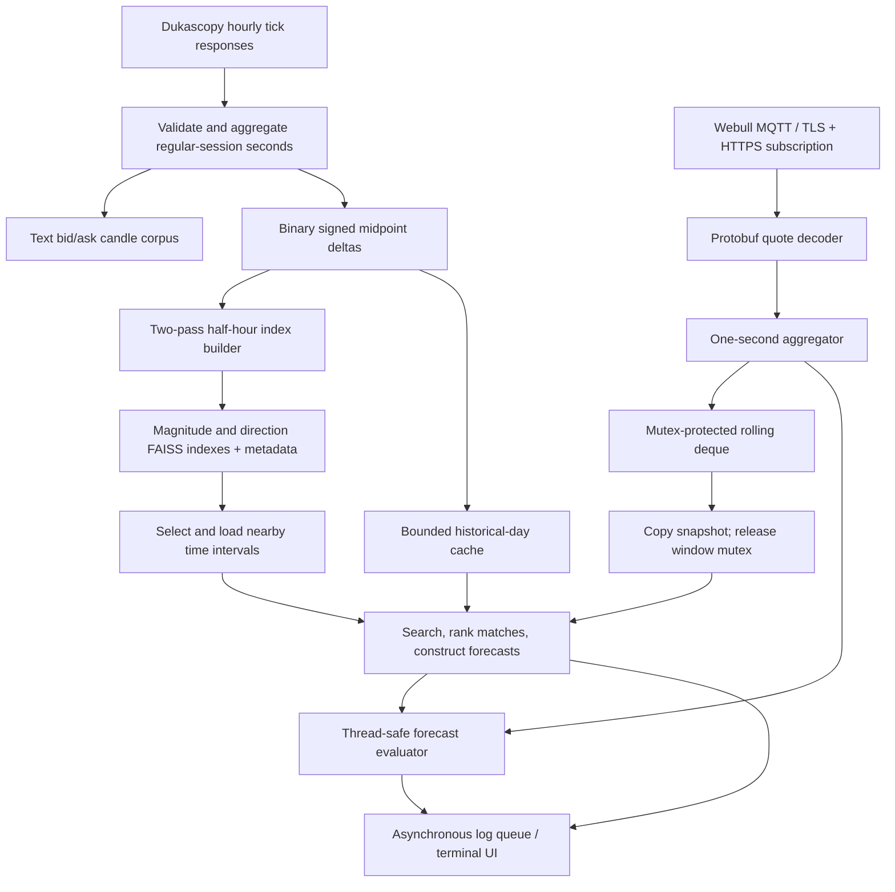

# Project Sonny

Sonny is an independently developed C++ market-data analysis and experimental forecasting system for SPY. It acquires historical quotes, builds compact one-second records and time-partitioned FAISS indexes, and compares incoming Webull quote windows with historical patterns. An FTXUI terminal interface controls setup and streaming, while a separate prediction loop generates and evaluates short-horizon forecasts.

The project is under active development. Its financial predictive usefulness has not been established. The measurements below describe engineering scale and one sandbox experiment; they do not establish trading profitability.

## Engineering Statistics

Collected **November 19, 2026** from local artifacts and the current working source. Exact counts, commands, configuration, evaluation tables, and uncertainty are recorded in [Engineering Metrics](docs/ENGINEERING_METRICS.md).

| Metric | Verified value |
|---|---|
| Historical coverage | 2,272 stored sessions, February 17, 2017–November 10, 2026; not every exchange trading day |
| Binary historical records | **53,164,800** records; 23,400 per stored session; **4 bytes per record** |
| Historical candle corpus | **2.77 GiB** of text bid/ask OHLC data; excludes validation markers |
| Binary record storage | **202.81 MiB** of unnormalized signed midpoint deltas |
| FAISS index storage | **7.92 GiB**, 26 exact `IndexFlatL2` indexes for the 20-second window |
| Index organization | 13 half-hour intervals × magnitude/direction; 53,121,632 historical windows represented in each index family |
| Index metadata | **1.19 GiB** of location metadata, plus 2,733 bytes of normalization JSON |
| Selective loading | Current limit: 3 intervals, up to 6 indexes; observed in the supplied run |
| Development hardware constraint | Approximately 16 GB system RAM, as reported by the developer; runtime RSS is unmeasured |
| Experimental evaluation | 111 forecast anchors per match cap; horizons 1–5 seconds; **sandbox**, November 19, 2026 |
| Query latency / peak runtime RAM | Unavailable; current logs do not measure these |

Storage uses binary units (GiB = 2³⁰ bytes, MiB = 2²⁰ bytes). Disk sizes are file lengths, not RAM measurements.

## Features and Capabilities

- Historical Dukascopy SPY acquisition, tick decoding, one-second aggregation, validation, and recoverable daily file replacement.
- Binary midpoint-change records and independently normalized magnitude indexes.
- Exact nearest-neighbor search through FAISS, with selective half-hour loading and cross-segment ranking.
- TLS MQTT quote ingestion, signed HTTPS subscriptions, Protobuf decoding, and read-only Secret Service credential lookup.
- Synchronized rolling input snapshots, historical-future lookup, weighted magnitude/direction forecasts, and subsequent-observation evaluation.
- Configurable experiments for input windows, match caps, and weekday-group direction indexes. Only the 20-second AllDays indexes exist in the measured storage snapshot.

## Architecture and Data Flow



The entry point starts logging and the UI. Menu operations dispatch work away from the UI thread. The [runtime orchestrator](src/runtime/runtime.cpp) assembles aggregation, the shared window, and the prediction experiment. [CMakeLists.txt](CMakeLists.txt) separates common infrastructure, core indexing, network clients, Webull decoding, and runtime code into static-library targets linked into `sonny`.

| Component | Responsibility and source |
|---|---|
| Historical ingestion | [Dukascopy exporter](src/dukascopy/dukascopy.cpp): hourly HTTP responses → decoded ticks → regular-session candles and records |
| Network utilities | [CurlRequest](src/client/curlrequest.hpp) and [SimpleCurlWrapper](src/client/simplecurlwrapper.cpp): request ownership, response callbacks, TLS verification; optional browser subprocess |
| Index construction | [Setup](src/core/setup.cpp), [normalization](src/core/transformer.cpp), and [half-hour indexes](src/core/halfhourmultiindex.cpp) |
| Index selection | [SessionMultiIndex](src/core/sessionmultiindex.cpp): bounded resident segments, common-scale ranking, duplicate-window removal |
| Streaming | [Webull client](src/client/webullstream.cpp), [MQTT wrapper](src/client/mqttwrapper.cpp), and [Protobuf schema](proto/webull/marketdata.proto) |
| Live processing | [OneSecondAggregator](src/runtime/onesecondaggregator.cpp), [LiveInputWindow](src/runtime/liveinputwindow.cpp), and [PredictionExperiment](src/runtime/predictionexperiment.cpp) |
| Forecasts and evaluation | [Forecast construction](src/runtime/forecast.cpp), [historical cache](src/runtime/historicalrecordstore.cpp), and [PredictionAnalytics](src/runtime/predictionanalytics.cpp) |
| Observability | [Logger](src/common/logger.cpp) and [FTXUI interface](src/ui/ui.hpp) |

## Key Technical Design Decisions

**Keep ingestion independent of search.** The ingestion callback emits one-second records and pushes them into a mutex-protected `std::deque`. The prediction operation copies a complete, updated window while holding that mutex, then releases it before index loading, FAISS search, historical lookup, and forecasting. This limits the work performed under the ingestion window lock; no throughput improvement has been benchmarked. Forecast evaluation has its own mutex because observations and forecast submissions arrive through separate execution paths.

**Bound index residency by time of day.** Historical windows are assigned to the half-hour in which they start. `SessionMultiIndex` selects a contiguous set around the live window's start interval and releases outgoing segments before loading replacements. A larger limit searches more of the historical session but uses more memory and exact-search work. This is a deliberate working-set control for development on a laptop with approximately 16 GB RAM, not an out-of-core FAISS search implementation.

**Keep the stored feature small and the search representations separate.** A record contains one float, `mid_delta`. Magnitude vectors use normalized absolute deltas; direction vectors use weighted signs. The full overlapping vectors are stored in FAISS, so indexes are much larger than the compact records. Separating these representations avoids cancellation when estimating the size of historical future moves; whether this improves forecasting requires evaluation.

**Make gaps and provenance visible.** Daily export checks, validation markers, missing-index handling, observed/unobserved live seconds, and configuration labels support diagnosis. They are not a complete experiment manifest: logs do not record a source revision, index checksum, all algorithm settings, or process memory.

## Historical Data and Storage

The [exporter](src/dukascopy/dukascopy.cpp) requests SPY tick data for the UTC hours intersecting **09:30–16:00 America/New_York**, following daylight-saving changes. It validates response arrays, timestamps, prices, multipliers, and tick continuity before producing 23,400 one-second candles. Quiet seconds carry the previous quote forward. Gaps longer than five minutes cause rejection; this heuristic cannot prove that the provider delivered every tick. An exchange holiday/early-close calendar is not implemented.

`storage/corpus/<date>.corpus` stores a daily multiplier and eight integer bid/ask OHLC columns. It is a derived candle corpus, not a raw-tick archive. `storage/records/<date>.rec` stores headerless native binary floats: the first delta is zero, and subsequent values are changes in the closing bid/ask midpoint. Each measured file is 93,600 bytes. Daily temporary files, backups, transaction markers, and fingerprints support recovery and reuse checks.

The `.rec` files remain signed and unnormalized. Normalized magnitudes are constructed during indexing; no separate normalized-record archive exists in this snapshot. The format assumes compatible float representation and endianness and has no embedded schema header. Source ticks, spreads, and volumes cannot be recovered from `.rec` alone.

## FAISS Indexing and Search

For each active input length, the [builder](src/core/setup.cpp) processes one half-hour at a time. Its first pass accumulates mean and population standard deviation of absolute deltas using Welford's algorithm. The second pass constructs overlapping vectors and their locations, adding days newest first to favor recent days in FAISS distance ties. Non-final segments include `window_length - 1` seconds of padding so windows can cross interval boundaries without being indexed twice. The final segment admits only complete windows.

The implementation integrates FAISS **`IndexFlatL2`**, which performs exact squared-Euclidean search over resident vectors. It does not implement FAISS itself or use an approximate/compressed index. The current 20-second collection has 4,089,600 vectors per index in each of the first twelve intervals and 4,046,432 in the final interval. Each family represents 53,121,632 windows; the two representations are not distinct historical observations.

Magnitude queries use the segment's saved normalization. Cross-segment magnitude distances are rescaled using a pooled standard deviation before ranking. Direction coordinates are `sign(delta) × sqrt(weight)`, with the current weight increasing linearly from **0.4 to 2.2** from oldest to newest second. Both stored vectors and queries use this transform. Candidates remain separate by representation; the runtime requests 128 per segment/index, merges and deduplicates them, then retains up to 32 usable matches with five seconds of historical future.

Paths are `storage/indexes/<N>s/{m,d}/<HHMM-HHMM>.index` and matching files under `storage/metadata/`. Each vector has a 12-byte location (record offset and eight-character trading date). Magnitude indexes also have normalization JSON. Optional weekday direction indexes use `d/weekdays/<group>/` and grouping manifests; `AllDays`, `WeekdayGroups`, and `Compare` modes are implemented, with separate comparison streams.

The measured runtime loaded three magnitude/direction pairs, not the entire 26-index collection. Their vector and location payloads total **2.10 GiB by calculation**, excluding capacity, allocation, cache, libraries, and other process costs; this is **not measured RSS**. A historical-day cache loads `.rec` files lazily and clears at a 4,096-day cap. See the [memory evidence](docs/ENGINEERING_METRICS.md#memory-and-residency) for limits and tradeoffs.

## Live Runtime and Concurrency

The Webull client connects with TLS MQTT 3.1.1, then binds a signed HTTPS subscription to the MQTT session. The client implements reconnect/backoff and resubscription, keeps sandbox/live credentials separate in Secret Service, and decodes `quote` payloads into owned C++ values. The current menu exposes **Sandbox → Sandbox Webull SPY Quote Stream**. Production endpoint configuration exists in the client, but no production runtime menu action is currently wired.

Two primary processing paths separate quote aggregation from periodic prediction. There are also UI, logger, stream-management, and Paho library execution threads; “two paths” is not a total process thread count. Paho invokes the quote handler through its callback bridge. The aggregator keeps the last quote per second, drops earlier-second arrivals, and emits a second only when a later quote arrives. Up to five quiet seconds are filled with zero deltas and marked unobserved; longer gaps or unusable books reset continuity.

The rolling window retains 20 records in the current mode. Only full, changed windows are snapshotted. The prediction loop waits five seconds between computations, so this is not a fixed five-second end-to-end deadline. Single-window mode preloads indexes while quotes accumulate. Escape requests stop; a scope guard stops/joins the stream-management worker before callback-captured pipeline state is destroyed, and remaining forecasts are flushed.

## Forecasting Methodology and Evaluation

For each historical match, the runtime reads the five signed deltas immediately **after** its input window. It estimates future magnitude as a weighted mean of absolute cumulative historical moves, while a separate direction match set votes on the cumulative move's sign. Magnitude weights are `1 / (squared_distance + 1e-6)^2`; direction weights are `1 / (1 + squared_distance)`. The signed forecast uses the full estimated magnitude in the winning direction and records agreement separately. Match caps **8, 16, and 32** are evaluated independently on the same snapshot.

The evaluator anchors forecasts to the last input timestamp and scores horizons **1, 2, 3, 4, and 5 seconds** against subsequent observations. A horizon is incomplete if any required second was not observed. A short observation history allows outcomes that arrive during computation to be applied when the forecast is submitted. This avoids feeding those outcomes into the input snapshot, but timely forecast availability must be measured separately.

The available November 19 log contains **one sandbox run, 09:37:26–09:47:17 as logged**, with 111 anchors and complete evaluations for each cap. All indexed location dates end November 10, before the log date. This supports evaluation against later stream observations, but the log lacks full payload timestamps/provenance to establish genuinely unseen **production** market data or independently exclude sandbox replay. No several-hour run is present in the available logs.

At the five-second horizon (111 samples per row, USD midpoint change):

| Match cap | Magnitude MAE¹ | Zero-move MAE | Signed forecast MAE | Direction accuracy |
|---|---:|---:|---:|---:|
| 8 | $0.065881 | $0.099955 | $0.119264 | 61/111 (54.95%) |
| 16 | $0.065825 | $0.099955 | $0.108449 | 66/111 (59.46%) |
| 32 | $0.063459 | $0.099955 | $0.111824 | 64/111 (57.66%) |

¹Magnitude MAE compares the separately logged estimated magnitude with the absolute observed move. Signed MAE includes directional mistakes. The majority-direction baseline at five seconds is 56/111 (**50.45%**), computed retrospectively from this sample. The full [report](docs/ENGINEERING_METRICS.md#forecast-evaluation) includes all horizons, baseline definitions, error reductions, and precision limits.

Magnitude error is lower than the zero-move baseline in this sample; **signed forecast MAE is worse than that baseline for every tested cap and horizon**. A zero-magnitude baseline is weak; no constant historical-magnitude or persistence baseline was logged. The short sandbox run, related forecasts, configuration selection, and lack of transaction-cost/execution analysis prevent claims of reliable predictive advantage or profitability.

## Linux Build Instructions

I'm providing examples for **Fedora**, my favorite, and **Ubuntu / WSL Ubuntu**.

### 1. Install Dependencies

The optional browser HTTP backend uses Node.js and Playwright. The current Dukascopy call path constructs the wrapper with its default direct-libcurl backend; it does not automatically fall back to the browser. To prepare the browser helper, install Node.js and npm, then install the dependencies declared in `package.json` and Playwright's Chromium browser:

```bash
npm install
npx playwright install chromium
```

Run these commands from the Sonny project root after cloning in Step 2. `npm install` uses `package-lock.json`; `npm ci` can be used for an installation that strictly follows the lockfile.

#### Fedora

```bash
sudo dnf install \
    clang \
    clang-tools-extra \
    gcc-c++ \
    cmake \
    ninja-build \
    nodejs \
    npm \
    git \
    curl \
    libcurl-devel \
    json-devel \
    libsecret-devel \
    libsecret-tools \
    openssl-devel \
    pkgconf-pkg-config \
    libomp-devel \
    openblas-devel \
    libsecret \
    gdb
```

#### Ubuntu / WSL Ubuntu

```bash
sudo apt update

sudo apt install \
    build-essential \
    clang \
    clangd \
    cmake \
    ninja-build \
    nodejs \
    npm \
    git \
    curl \
    libcurl4-openssl-dev \
    nlohmann-json3-dev \
    libomp-dev \
    libopenblas-dev \
    libsecret-tools \
    libsecret-1-dev \
    libssl-dev \
    pkg-config \
    gdb
```

Verify the main tools:

```bash
clang++ --version
cmake --version
ninja --version
git --version
```

CMake **3.23 or newer** is required by Sonny's top-level configuration.

Sonny uses **C++26**, so the installed Clang version must support `-std=c++26`. Its C++ standard library must also supply `std::format` and C++20 chrono time-zone support, with system time-zone data available. Distribution defaults may be too old; the inspected local build uses Clang 23.1.5. The package commands are Linux setup examples, not fresh-install verification for every distribution release.

**WSL:** Keep the project inside the Linux filesystem (for example `~/Sonny`) rather than `/mnt/c/...`.

---

### 2. Clone Sonny

```bash
cd ~
git clone https://github.com/Evan-Montano/Sonny.git Sonny
cd ~/Sonny
```

The examples below assume the project is located at:

```text
~/Sonny/
```

---

### 3. Clone FAISS

FAISS is built from a nested checkout inside Sonny. The inspected repository records `faiss` as a Git link but supplies no `.gitmodules` file; the following command populates it when no checkout is present. If the directory already contains a checkout, use it rather than cloning over it.

```bash
cd ~/Sonny

git clone --depth 1 https://github.com/facebookresearch/faiss.git faiss
```

The resulting layout is:

```text
~/Sonny/
├── CMakeLists.txt
├── src/
├── faiss/
└── build/
```

---

### 4. Build and Install FAISS

FAISS must be built before Sonny.

```bash
cd ~/Sonny/faiss

cmake -S . -B build \
    -DCMAKE_BUILD_TYPE=Release \
    -DCMAKE_INSTALL_PREFIX="$HOME/.local/faiss" \
    -DFAISS_ENABLE_GPU=OFF \
    -DFAISS_ENABLE_PYTHON=OFF \
    -DBUILD_TESTING=OFF

cmake --build build --target faiss
cmake --install build
```

FAISS will be installed to:

```text
~/.local/faiss
```

---

### 5. Clone, Build, and Install Google Protocol Buffers

Sonny uses Google's Protocol Buffers (Protobuf) library to deserialize binary messages received through the Webull MQTT quote stream.

Protobuf consists of two important components:

- **libprotobuf:** The C++ runtime library used to deserialize messages.
- **protoc:** The Protocol Buffers compiler, which generates C++ source and header files from `.proto` definitions.

Both must be installed.

Use the same Protobuf source revision, compiler, and runtime across development environments. The clone command below follows upstream HEAD and is **not pinned**; the installed `protoc` and linked runtime must come from the same build. The inspected local checkout is `c0d0827c8d52ab52afdf4ee477b58e78b4c903ef` and reports `38.0-dev`, rather than the README's previously stated 36.2.

Unlike FAISS, Protobuf's source, build artifacts, and installation are all kept together in the Sonny directory.

#### Clone Protobuf

```bash
cd ~/Sonny

git clone --depth 1 https://github.com/protocolbuffers/protobuf.git protobuf
```

#### Configure Protobuf

```bash
cmake -S ~/Sonny/protobuf \
    -B ~/Sonny/protobuf/build \
    -G Ninja \
    -DCMAKE_BUILD_TYPE=Release \
    -DCMAKE_INSTALL_PREFIX="$HOME/Sonny/protobuf/install" \
    -DCMAKE_C_COMPILER=clang \
    -DCMAKE_CXX_COMPILER=clang++ \
    -DCMAKE_CXX_STANDARD=17 \
    -Dprotobuf_BUILD_TESTS=OFF \
    -Dprotobuf_BUILD_SHARED_LIBS=OFF
```

A few notes:

- Protobuf requires C++17 or newer. It can be built with C++17 independently of Sonny's C++26 standard.
- Tests are disabled to avoid building Protobuf's test suite.
- Static libraries are used for consistency with Sonny's other statically built dependencies.
- CMake automatically fetches Abseil if it is not already installed.

#### Build and Install

```bash
cmake --build ~/Sonny/protobuf/build --parallel 4

cmake --install ~/Sonny/protobuf/build
```

Protobuf will be installed to:

```text
~/Sonny/protobuf/install
```

#### Verify Installation

Check the Protobuf compiler:

```bash
~/Sonny/protobuf/install/bin/protoc --version
```

The version should match the source you built. On the inspected November 19 checkout:

```text
libprotoc 38.0-dev
```

Verify that the headers and libraries were installed:

```bash
test -f ~/Sonny/protobuf/install/include/google/protobuf/message.h \
    && echo "Protobuf headers installed"

find ~/Sonny/protobuf/install -name 'libprotobuf*'
```

---

### 6. Build Sonny

Return to the Sonny root directory:

```bash
cd ~/Sonny
```

Configure Sonny:

```bash
cmake -S . -B build -G Ninja \
    -DCMAKE_C_COMPILER=clang \
    -DCMAKE_CXX_COMPILER=clang++ \
    -DCMAKE_PREFIX_PATH="$HOME/.local/faiss;$HOME/Sonny/protobuf/install"
```

Build:

```bash
cmake --build build
```

FTXUI v7.0.3, GoogleTest v1.18.0, and Paho MQTT C++ v1.6.0 (including its C dependency) are fetched by CMake through `FetchContent`. Initial configuration requires network access. FAISS and Protobuf are found through the installation prefixes above; Protobuf's own dependency acquisition also requires network access when uncached.

---

### 7. Run Sonny

Launch from the project root so relative `storage/` paths resolve correctly:

```bash
./build/sonny
```

---

### 8. Normal Development

After the initial setup, FAISS and Protobuf do not need to be rebuilt every time Sonny changes.

```bash
cd ~/Sonny
cmake --build build
./build/sonny
```

---

### 9. Clean Rebuild

If CMake or the build configuration becomes corrupted, remove the build directories:

```bash
cd ~/Sonny

rm -rf build
rm -rf faiss/build
```

For a complete Protobuf rebuild, also remove its build and installation directories:

```bash
rm -rf protobuf/build
rm -rf protobuf/install
```

Then repeat **Step 4**, **Step 5**, and **Step 6**.

---

### Directory Reference

| Directory | Purpose |
|---|---|
| `~/Sonny` | Sonny source |
| `~/Sonny/faiss` | FAISS source |
| `~/Sonny/build` | Sonny build |
| `~/Sonny/faiss/build` | FAISS build |
| `~/Sonny/protobuf` | Protobuf source |
| `~/Sonny/protobuf/build` | Protobuf build |
| `~/Sonny/protobuf/install` | Installed Protobuf |
| `~/.local/faiss` | Installed FAISS |

### CMake Configuration

Sonny currently uses:

- **C++26**
- **Clang / Clang++**
- **Ninja**
- **FTXUI 7.0.3**
- **FAISS**
- **Google Protocol Buffers** (matched compiler/runtime; inspected local version 38.0-dev)
- **libcurl**
- **nlohmann/json**
- **OpenMP**
- **Paho MQTT C++ / C** (fetched and built statically with TLS by CMake)
- **libsecret** (read-only Secret Service access)

See [docs/webull-streaming.md](docs/webull-streaming.md) for OpenAPI application setup, Secret Service provisioning, and live/sandbox quote-stream details.

Linux builds are configured as **Debug** builds with debugging symbols and optimizations disabled, for now while development is still in progress.

The top-level CMake file currently forces `Debug` and `-g -O0`; passing `-DCMAKE_BUILD_TYPE=Release` does not override that assignment. FAISS is built separately with the Release command above. Dependency clone commands follow upstream HEAD; retain source revisions for repeatable builds. No clean dependency rebuild was performed for this documentation review.

## Configuration and Usage

Configuration is primarily compile-time; rebuild after changing these settings. `main` does not parse command-line options, and the empty root `config.json` does not configure the current pipeline.

| Source | Current settings and effect |
|---|---|
| [setup.hpp](src/core/setup.hpp) | Historical range February 17, 2017–November 10, 2026; `REUSE_EXISTING_INDEXES=false`, so Update Indexes rebuilds selected indexes |
| [inputconfig.hpp](src/core/inputconfig.hpp) | Supported windows: 10/15/20/30/45/60 seconds; single 20-second window active; maximum 3 resident segments |
| [weekdayconfig.hpp](src/core/weekdayconfig.hpp) | `AllDays` active; five single-weekday groups available; `Compare` keeps all-week and weekday results separate |
| [predictionexperiment.hpp](src/runtime/predictionexperiment.hpp) | 8/16/32 match caps; 128 search candidates per sub-index/segment |
| [predictionanalytics.hpp](src/runtime/predictionanalytics.hpp) | Evaluation horizons 1–5 seconds |

From **Setup**, choose **Download Missing Records (Keeps Existing)** to acquire absent or invalid days, then **Update Indexes** for the active configuration. Download/rebuild operations can take substantial time. **Run All Setup Processes (Clears Everything)** deletes corpus, record, and index directories before rebuilding; **Download Historical Records (Clears Existing)** replaces daily exports. **Clear Log File** truncates the current day's evidence after a UI confirmation. Keep experiment logs before using it.

Use **Sandbox → Sandbox Webull SPY Quote Stream** to start the current runtime and **Escape** to return. Streaming requires the selected environment's `app_key` and `app_secret` in an unlocked Linux Secret Service provider; an access token is used if provisioned. Follow [Webull streaming setup](docs/webull-streaming.md) for the existing provisioning commands. Build and unit tests do not require credentials.

“Update Indexes” builds only active input windows and selected direction families. With reuse enabled, completeness checks do not fingerprint source records or direction-weight settings; rebuild after changing data, date ranges, or vector construction. Weekday manifests do validate the configured grouping. Log files are appended under `storage/logs/<local-date>.log` and may be explicitly cleared through the UI. Historical storage, dependencies, and logs are not bundled as public experiment artifacts.

The helper scripts provide the same workflow: `./build.sh` configures/builds Sonny using existing dependencies; `./tests.sh` runs CTest; `./full-build.sh` deletes dependency/application build directories, rebuilds, installs, and tests. The full script expects FAISS and Protobuf source directories to exist.

## Testing

```bash
cmake --build build --target sonny_common_tests
ctest --test-dir build --output-on-failure
# Or, after building:
./tests.sh
```

GoogleTest cases cover date/time and JSON helpers, vector construction and normalization, index persistence and ranking, segment selection, weekday grouping, Webull signing/schema behavior, aggregation, rolling snapshots, historical lookup, and forecast construction. Tests use small fixtures and temporary storage; they do not establish external service reliability, forecast quality, or runtime throughput. The [metrics report](docs/ENGINEERING_METRICS.md#verification) records the dated test result and verification scope. `npm test` is a placeholder, not the C++ test runner.

## Engineering Highlights

- Designed an end-to-end C++ system spanning historical acquisition, binary storage, similarity search, streaming ingestion, and experimental evaluation.
- Implemented four-byte one-second records for a measured 53.16-million-record historical dataset, with daily validation and recoverable file replacement.
- Integrated FAISS exact search into 13 time partitions and separate magnitude/direction representations, managing a 7.92 GiB index collection through selective loading.
- Separated quote processing from forecast computation using mutex-protected rolling snapshots, independent evaluator synchronization, and managed stream shutdown.
- Integrated signed HTTPS, TLS MQTT, Protobuf decoding, Secret Service credentials, and a terminal UI; compared independently labeled forecast configurations against subsequent sandbox observations.

## Current Limitations and Future Development

Financial predictive usefulness remains unestablished. Production out-of-sample validation, stronger baselines, longer retained experiments, and forecast availability timing remain necessary. Exact flat search duplicates overlapping vectors and trades search coverage against memory; there is no compressed index or disk-backed search. Runtime RSS, query latency distributions, quote rates, construction times, and isolated evaluation throughput remain unmeasured.

Historical sessions use a fixed regular-session length without a holiday/early-close calendar. The live clock rejects premarket/weekends but clamps after-hours timestamps to the final session second rather than rejecting them. The record format has no portable schema header, and experiment/index provenance is incomplete. Detailed limitations and proposed instrumentation are in [Engineering Metrics](docs/ENGINEERING_METRICS.md#unavailable-measurements-and-next-instrumentation).
